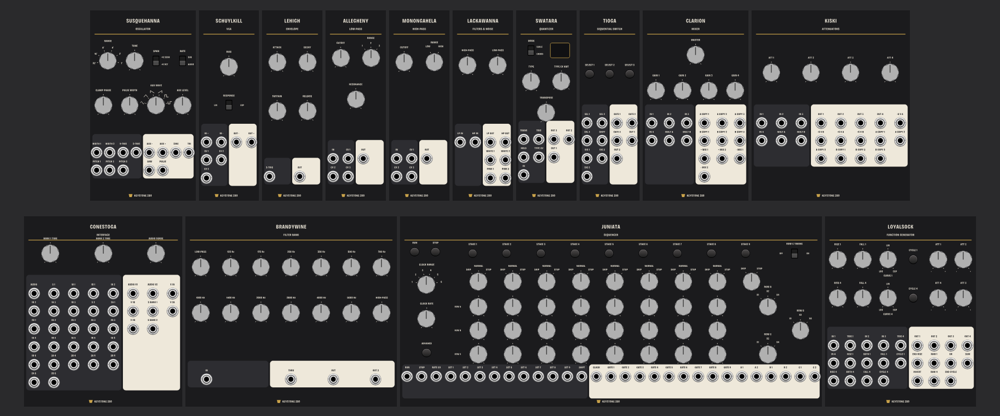

# Keystone 280

Fourteen VCV Rack 2 modules modelled on a real modular rack.



These modules are based on the hardware in my own rack: a Behringer System 15, Behringer's take on the classic 1960s Moog 900-series modules, plus a few others. I measured the rack on the bench (pitch, levels, waveforms, filter response, envelope times and sequencer timing) and tuned the models to those recordings. They're close, not identical. Each module is named after a Pennsylvania river.

## Modules

| Module | What it does |
| :--- | :--- |
| Susquehanna Oscillator | Oscillator with six octave ranges, a sub-audio mode, pulse width and clamp sync. Four waveform outputs plus a selectable aux output. |
| Schuylkill VCA | Linear or exponential VCA with three summed CV inputs and inverted outputs. |
| Lehigh Envelope | ADSR envelope with an active-low trigger input, up to about 30 s per stage. |
| Allegheny Low-Pass | Four-pole ladder low-pass with three ranges and resonance up to self-oscillation. |
| Monongahela High-Pass | Four-pole high-pass with two ranges. |
| Lackawanna Filters & Noise | A simple low-pass and high-pass pair plus white and pink noise. |
| Brandywine Filter Bank | Twelve fixed bands with level controls, plus low-pass and high-pass ends. |
| Juniata Sequencer | Three rows by eight stages with its own clock, per-stage modes and optional third-row timing. |
| Conestoga Interface | Turns audio and voltages into triggers: two timed trigger banks and a signal detector. |
| Tioga Sequential Switch | Steps a signal through two or three outputs, or selects one directly. |
| Clarion Mixer | Four-channel mixer with inverted outputs and signal copies. |
| Kiski Attenuators | Four attenuators, signal copies and fixed reference voltages. |
| Loyalsock Function Generator | Two rise/fall generators that can cycle as LFOs, four attenuverters, sum and max outputs. |
| Swatara Quantizer | Scale and chord quantizer with three outputs, a shift register and a hold loop. |

All jacks are monophonic. Controls, voltages and patch ideas for every module are in the [manual](docs/MANUAL.md).

## Install

Once the plugin is listed in the VCV Library, install it from there (search "Keystone 280"). Until then, download the `.vcvplugin` file for your system from [Releases](https://github.com/MichaelAPerry/keystone280-vcv/releases), put it in Rack's plugins folder (Help > Open user folder), and restart Rack.

## How it was made

I recorded and measured each module on my rack, then tuned the models until they matched. [CALIBRATION.md](CALIBRATION.md) lists, module by module, what was measured and what came from documentation.

The code was written by AI coding agents (Claude and Codex) working from my plans, measurements and listening. I directed the work and checked it against the real rack. Automated tests run on every change, including a crash test that throws noise, extreme voltages and invalid values at every input.

## Build

Install GNU Make, a C++17 compiler, `jq` and `zstd`. Download the [Rack 2 SDK](https://vcvrack.com/downloads/) for your target platform and architecture. On macOS, use the Xcode Command Line Tools.

```sh
make -j4 RACK_DIR=/path/to/Rack-SDK
make dist RACK_DIR=/path/to/Rack-SDK
```

The package is written to `dist/`. For Windows cross-compilation, use a Windows x64 Rack SDK and pass the MinGW compiler prefix, including the final dash, as `CROSS`.

```sh
make dist RACK_DIR=/path/to/windows/Rack-SDK CROSS=/path/to/bin/x86_64-w64-mingw32-
make -C tests
```

Clean the build before switching target platforms. The [native tests](tests/README.md) use `g++` and Python 3 and can run without a Rack SDK.

## Panels

The YAML files in `layout/` define the panel artwork and widget positions. The generated SVG files use outlined glyphs. The Rack build uses the checked-in SVGs and headers directly.

```sh
python3 -m pip install fonttools brotli pyyaml
python3 tools/panel.py
python3 tools/check_panels.py
```

## Credits and license

Panels use Bricolage Grotesque under the [SIL Open Font License 1.1](tools/fonts/OFL.txt). The code is licensed under [GPL-3.0-or-later](LICENSE).

Behringer and Moog are trademarks of their respective owners. This project is not affiliated with or endorsed by either company.
